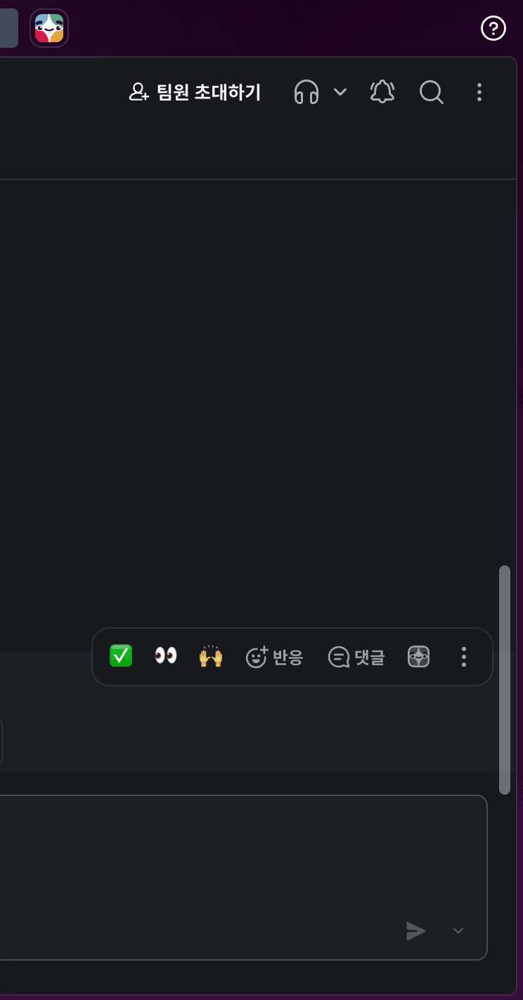
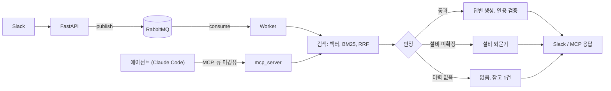

# Event-Driven RAG System

Slack에서 "이 장애가 이전에도 발생했나요?"라고 질문하면 과거 장애 이력을 검색하고, 근거 티켓과 함께 답변하는 이벤트 기반 RAG 시스템입니다.

Python · FastAPI · RabbitMQ · LangGraph · Qdrant · Kiwi/BM25 · Docker Compose

## 데모


질문 → "검색 중…" → 근거 티켓 2건과 함께 스레드 답변. 질문부터 답변까지 19.4초(로그 기준, 녹화 25.3초).

<details>
<summary>설비명이 없는 질문은 먼저 되묻는다 (두 번째 데모, 51초)</summary>

<br>



"챔버 진공이 계속 떨어지는데"처럼 설비가 없는 질문은 후보 설비 3개(PECVD / PVD / ETCH)를 먼저 묻고, 사용자가 "PECVD-03"을 고르면 해당 설비로 재검색해 근거 티켓 4건을 답합니다. 되묻기까지 6.9초, 최종 답변까지 25.6초.
</details>

## 아키텍처



입구가 둘(Slack은 큐를 거치는 비동기, MCP는 큐 없이 같은 코어를 직접 호출하는 동기)이고 본체는 하나입니다. 판정 조건(cosine 안전선 0.50 + LLM 티켓별 yes/no 5건 중 2건, 또는 로컬 cross-encoder), 재시도·DLQ 경로, 집계 도구 호출은 아래 [설계 결정](#설계-결정)과 `docs/events.md`에 있습니다.

## 결과

합성 티켓 318건을 대상으로 평가했습니다. 기본 평가셋은 positive 139건과 negative 31건을 포함한 170행이며, 검색 결과는 k=5로 측정했습니다. 모든 검색 방식에 동일한 bge-m3 색인을 사용했습니다. 전체 결과는 `domains/manufacturing/eval/experiments.jsonl`, 요약은 `docs/experiments/week3_summary.md`에서 확인할 수 있습니다.

11월 3일에는 질의 108행을 추가해 총 283행(현실 문체 질의 124건, negative 39건 별도)으로 재평가했습니다. 해당 결과는 아래 별도 표에 정리했으며, 주요 수치는 `docs/log/2026-11-02.md`를 기준으로 했습니다. 첫 번째 비교 표는 기존 170행 평가셋 기준입니다.

벡터 검색만으로도 R@5가 0.885를 기록해 하이브리드 검색 적용 후에도 변화가 없었습니다. 따라서 R@1, MRR 및 Negative 판정률을 주요 비교 지표로 확인했습니다.

| 검색 방식 | 직접 작성 질의 R@1 / MRR | 코드 질의 3종 (5건 중) | 전체 R@1 / R@5 / MRR | negative "이력 없음" (31건) |
|---|---|---|---|---|
| 벡터 only | 0.632 / 0.724 | 0 · 1 · 5 | 0.763 / 0.885 / 0.636 | — |
| BM25 only (Kiwi, 사전 80) | 0.684 / 0.784 | 5 · 5 · 5 | 0.727 / 0.856 / 0.613 | — |
| 하이브리드 (RRF k=60, 1:1) | 0.737 / 0.798 | 3 · 3 · 5 | 0.784 / 0.885 / 0.656 | — |
| 하이브리드 + 메타데이터 필터 | **0.789 / 0.842** | **5 · 5 · 5** | **0.791 / 0.885 / 0.665** | — |
| + negative grade (LangGraph) | 검색 동일 | 검색 동일 | R@5 0.885 유지 (판정이 거른 정답 0) | **0.968** · positive 오판 0.014 · LLM 5.67회/질의 · +4.7s |
| + 설비 되묻기 (Step 9) | 124행 R@5 0.75 → **0.831** · R@1 0.492 → 0.581 | 발동 0 | 170행 불변 | 발동 0/39 |

- 코드 질의 3종은 "E-1101" · "PECVD-03 E-1101" · "E-5201"이며, 각 질의 5건 중 검색된 정답 수를 표시했습니다. 되묻기 결과는 현실 문체 질의 124건에서 사용자가 정답 설비를 선택한 경우입니다. 이때 R@5 상한은 0.871이며, 되묻기는 44/124건에서 발동했습니다. 발동한 질의의 LLM 호출은 11회였습니다. 코드 또는 설비 정보가 포함된 질의에는 되묻기가 적용되지 않습니다.
- GitHub 이슈 평가에서는 docker/compose 관련 중복 이슈 46쌍과 코퍼스 2,600건을 사용했습니다. R@5는 벡터 검색 0.630 [0.478, 0.761], BM25 0.609 [0.478, 0.739], **하이브리드 0.783** [0.652, 0.891]입니다. 영문 토크나이저에는 어간 처리, 불용어 제거, 식별자 보존을 적용했습니다. 평가 표본이 46쌍으로 적어 신뢰구간이 겹치므로 결과 해석에 유의해야 합니다.

**Step 11 — 도구 호출 평가(집계 도구) · 95행(multi_hop 30 · 조치·시간 23 · 과거 이력 12 · exact 대조 30), 정답 = 정답 원인 기준 전체 이력 집계(건수·평균/중앙 다운타임·최근 발생일), 11-09**

| | 도구 off | 도구 on (`GRAPH_TOOLS=1`, 기본) |
|---|---|---|
| multi_hop 30 — 숫자 하나라도 맞음 (건수 / 다운타임 / 최근) | 0.233 (0 / 0 / 0.233) | **0.567** (0.5 / 0.333 / 0.267) |
| multi_hop 도구 호출 / 호출했을 때 도구 숫자를 그대로 씀 / 필터가 정답 원인 | 0 | 20/30 · **0.85** · 0.6 (나머지는 설비·알람 단위로 더 넓게 집계 — 숫자는 맞고 질문의 단위가 다름) |
| 대조군(exact 30 · 조치·시간 23 · 과거 이력 12) 오호출 | 0 | **0/65** |
| 인용 R@5 (전체 95) | 0.716 | 0.716 (검색·판정 불변) |
| LLM 호출 / 토큰 / 비용 / 지연 (전체 95) | 5.76 / 7,157 / $0.0071 / 21.4s | 5.98 / 8,305 / $0.0079 / 23.7s (multi_hop만 +2,473 토큰 · +5.8s) |

도구를 호출하지 않은 multi_hop 10건은 "증상 묶음의 원인별 분포"처럼 티켓에 집계 기준이 없는 질문이었습니다. 현재 도구는 원인·설비·알람·기간을 기준으로 집계하므로 이러한 질문에는 적용할 수 없으며, 모델이 검색 상위 5건을 바탕으로 답변했습니다. MCP의 `search_tickets`와 `get_ticket`을 통해 에이전트가 직접 집계하는 경로도 제공합니다.

**현실 문체 질의 124건(직접 작성 10 · ChatGPT 초안 95 · Claude 초안 19)** — 11-03, 283행 평가셋 기준(negative 39 별도). 사람 10 = 사용자가 직접 쓴 줄(`#human`), ChatGPT 초안 = 사용자가 7개 유형(설비 생략·구어/오타·맥락 노이즈·코드·복합 증상·조치/시간·과거 이력)으로 추가한 108줄 중 positive 95, Claude 초안 = 1주차 19줄.

| 검색 방식 | 124 R@1 / R@5 / MRR | 사람 10 R@5 | ChatGPT 초안 95 R@5 | Claude 초안 19 R@5 |
|---|---|---|---|---|
| 벡터 only | 0.444 / 0.637 / 0.523 | 0.4 | 0.621 | 0.842 |
| BM25 only | 0.435 / 0.669 / 0.518 | **0.5** | 0.632 | **0.947** |
| 하이브리드 | 0.452 / 0.734 / 0.541 | **0.6** | 0.716 | 0.895 |
| 하이브리드 + 메타데이터 필터 | **0.492 / 0.75 / 0.579** | **0.6** | **0.737** | 0.895 |
| + 설비 되묻기, 사용자가 정답 설비로 답(실측, 발동 44/124) | 0.581 / **0.831** | 0.6 → 0.8 | 0.737 → 0.853 | 0.895 → 0.895 |
| + 정답 설비 강제 필터(되묻기 상한) | 0.581 / 0.871 | | | |

실패(하이브리드+필터 R@5 0) 31건 중 약 18건은 증상이 복수 원인에 걸쳐 설비 없이는 미결정("진공이 계속 떨어진다" = PECVD O-ring·드라이펌프 / PVD 크라이오펌프 / ETCH 스로틀 밸브, "히터 온도가 안 올라온다" = PHOTO 핫플레이트 / PECVD 서셉터 / PVD 웨이퍼 히터). 나머지는 카탈로그가 confusable로 선언한 같은 설비 안의 이웃 원인(연마 패드 ↔ 컨디셔너·슬러리). 정답 티켓의 설비 종류를 필터로 강제하면(사용자가 설비를 답했을 때의 상한) 124건 R@5 0.75 → 0.871. 실제 되묻기 노드(grade 통과 티켓이 설비 2종 이상 + 질의에 설비·코드 없음)는 44건에 발동, 사용자가 정답 설비로 답하면 0.831(발동 44건만 보면 0.682 → 0.909), negative 39건에는 발동 0. 발동 안 한 실패 17건은 연마 패드(8)·O-ring(5)·핫플레이트(3) — 같은 설비 안의 confusable이라 그룹(정답 ∪ confusable) R@5로는 0.529. 유형별로는 코드만 질의가 필터로 1.0, 설비 생략 질의가 0.62 → 0.76.

- paraphrase_hard(티켓 용어를 전혀 안 쓴 질의 30행)는 R@5 0.60 → 0.567로 하이브리드가 못 살린다. 임베딩 한계로 두고 숫자만 보고한다.
- negative는 cosine 임계값만으로 분리되지 않는다(positive min 0.535 vs negative max 0.613 겹침). 임계값은 안전선(0.50), 판정은 LLM(티켓별 yes/no, 5건 중 2건 이상).
- 노이즈 주입(79행, 규칙 기반 오타·약어): 오타 30%는 어느 쪽도 안 무너지고, 약어+오타 30%에서 벡터만 R@5 0.962 → 0.924. 하이브리드는 전 세트 0.975 유지(R@1만 0.924 → 0.886). 사전·코드 정규식 기여는 ±0.013로 분리 불가. graph(LLM 판정) 행은 오타 1~2곳·약어 세트만 측정(잘못 "이력 없음" 1.4%), 30% 세트는 미완(API 장애 — OpenAI 크레딧 소진). docs/log/2026-11-02.md Step 7.
- GitHub 이슈(실제 텍스트, 영문): 중복 이슈 → 원본 찾기. R@5 방향은 합성과 같다(hybrid > vector > bm25). 토크나이저는 도메인 설정(`tokenizer.yaml`)으로 교체 — 영문은 어간·불용어·snake_case/버전 보존. n=46이라 CI가 겹친다. 수집·누수 차단 규칙은 `scripts/collect_github_issues.py`.

## 설계 결정

<!-- 각 항목은 3줄 이내로 정리. docs/log/의 "결정" 항목을 기준으로 작성. -->
- **RabbitMQ (Kafka 대신)** — 이 프로젝트는 대규모 스트리밍보다 작업 분배와 실패 처리에 초점을 둔 작업 큐가 필요했습니다. RabbitMQ의 재시도 및 DLQ 기능이 요구사항에 적합하다고 판단했습니다.
- **원인 카탈로그 → 합성 티켓** — LLM의 도움으로 초안을 작성한 뒤, 전공 과정에서 학습한 반도체 공정 지식을 바탕으로 가상 카탈로그를 검토했습니다(검토 범위: `docs/catalog_review.md`). `root_cause`는 사람이 지정하고 LLM은 표현 생성에만 활용했습니다. 역분류 검증(2심 + 사람 판정, `docs/labeling_policy.md`)으로 라벨의 일관성을 확인했습니다.
- **임베딩 모델은 bge-m3 유지** — bge-m3 · Qwen3-Embedding-0.6B · KURE-v1을 같은 평가 환경에서 비교했습니다(벡터 컬렉션만 교체). 실제 운영 검색 방식인 hybrid + 메타데이터 필터의 R@5(현실 문체 124행)가 0.750 / 0.750 / 0.734로, 사전에 정한 기준(±0.03) 안이라 유의미한 차이가 확인되지 않아 기존 bge-m3를 유지하기로 했습니다. 상세 결과는 [임베딩 모델 비교 실험](docs/experiments/step12_embedding.md)에 기록했습니다.
- **RRF 1:1 고정 (가중치 튜닝 미실시)** — 평가셋 170행에 맞춘 가중치 튜닝은 과적합 가능성이 있다고 판단했습니다. 순위 기반 결합을 사용하므로 cosine과 BM25 점수의 스케일을 별도로 정규화하지 않았습니다. 코드 질의는 하이브리드 검색에 섞지 않고 BM25 검색으로 라우팅했습니다.
- **Kiwi 사용자 사전 자동 검출** — 카탈로그 문장을 문맥과 함께 분석해 기본 Kiwi가 잘못 분리하는 단어만 등록했습니다(80개). 예를 들어 베인→베이+ㄴ, 리크→리+크, 미도달→미+도달과 같은 사례입니다. 카탈로그 단어를 모두 등록한 경우 145개 항목은 효과가 없었습니다.
- **LLM 기반 관련성 판정** — cosine 임계값만으로 negative 질의의 90%를 구분하려면 positive 질의 약 10%를 놓치는 문제가 있었습니다. 이를 보완하기 위해 티켓별 yes/no 판정과 "5건 중 2건 이상" 규칙을 적용했습니다. 그 결과 negative 판정률은 0.968이었고 정답 유실은 없었습니다. 배치 1회 판정 방식은 모든 주요 지표에서 성능이 낮아 제외했습니다.
- **설비 되묻기는 Grade 이후에 실행** — 검색 결과만으로 되묻기를 판단하면 negative 39건 중 25건이 여러 설비가 포함됐다는 이유로 되묻기 대상이 되어 "이력 없음" 판정을 방해했습니다. 먼저 LLM 판정으로 negative를 제외한 뒤, 통과한 티켓에 2종 이상의 설비가 포함된 경우에만 되묻도록 변경했습니다. 이 과정에서 추가 LLM 호출은 발생하지 않으며, 되묻기가 발생한 질의에 대해서만 판정을 2회 수행합니다. 되묻기는 Redis 상태를 이용해 스레드당 1회로 제한했습니다(300초).
- **At-least-once 처리와 멱등성 키의 수명** — drain 타임아웃으로 처리하지 못한 메시지는 브로커가 재전달하지만, 멱등성 키가 남아 있으면 다음 워커도 해당 메시지를 중복으로 판단해 버리는 문제가 있었습니다(유실 가능 시간 300초). 메시지를 재전달하도록 넘기는 시점에 키를 해제해 이 문제를 해결했습니다.

## 기각된 실험

| 실험 | 결과 | 제외한 이유 |
|---|---|---|
| symptom_only 색인 (증상만, 조치 기록 제외) | 전체 R@5 0.853 → 0.872, 사람 질의 0.842 → 0.789 | LLM 질의의 성능 향상은 출처 티켓의 증상을 바꿔 쓴 영향일 가능성이 있습니다. 실제 사람 질의의 성능은 하락해 적용하지 않았습니다(1주차). |
| Kiwi 사전 v1 (카탈로그 단어 전부 188개) | v2(잘못 분리되는 단어만 80개)와 R@5 0.842 vs 0.856 | 145개 항목은 Kiwi가 이미 하나의 토큰으로 처리해 등록 효과가 없었습니다. 이후 필요한 단어만 자동 검출하는 방식으로 변경했습니다. |
| Grade 배치 1회 판정 (티켓 5건을 한 번에 호출) | negative 0.871 · positive 오판 0.072 · 정답 6건 제외 · 20.8s | 호출 수는 1/3로 줄었지만 정확도와 지연 시간이 모두 악화됐습니다. 한 번에 전달된 목록 안에서 상대 비교가 발생해 yes 판정이 불안정해지는 문제가 있었습니다. |
| RRF 가중치 튜닝 | 미실시 | 평가셋 170행에 맞춘 튜닝은 과적합 우려가 있어 진행하지 않았습니다. 코드 질의는 가중치 조정 대신 검색 방식 라우팅으로 처리했습니다. |
| cross-encoder 학습에 confusable 쌍을 라벨 0으로 포함 (all 변형) | 제외 변형 대비 쌍 AUC 0.931 vs 0.922로 높지만 positive false no_match 0.158 vs 0.070, 정답 유실 2 vs 1 (val 65) | 카탈로그가 "헷갈림"으로 선언한 이웃 원인 티켓을 0으로 가르치면 모델이 이웃까지 버린다 — 정답이 상위 5에 1건뿐인 질의에서 그 이웃이 "5건 중 2 yes"의 두 번째 yes였다. 쌍을 잘 가르는 것과 질의를 살리는 것이 다른 목표 (3주차 Step 10) |

## 신뢰성 검증

| 상황 | 결과 | 어디에 |
|---|---|---|
| 브로커 재시작 (메시지 10건 적재 후 `restart rabbitmq`) | 유실 0 (durable 큐 + persistent 메시지) | docs/log/2026-10-29 |
| 워커 종료 중 LLM 호출 (`docker compose stop worker`) | 처리 중 1건을 끝내고 나감(drain 120s), 답 도착, ai_tasks 0 | docs/log/2026-10-29 |
| 처리 실패 3회 | 5s → 25s → 125s 재시도 큐 → DLQ(원문·마지막 오류 보존) | tests/test_worker.py |
| 같은 event_id 2회 (Slack 재전송) | 1회만 처리 (Redis SET NX, 24h). Redis 장애면 가드 없이 처리 | tests/test_worker.py |
| **drain 타임아웃 초과** (`WORKER_DRAIN_TIMEOUT=5`) | requeue는 되지만 멱등 키 때문에 300s 동안 중복으로 버려졌다 → 버릴 때 키 release로 유실 창 0 | docs/log/2026-11-02, test_k |
| shell form CMD (PID 1 = sh) | SIGTERM이 python에 안 가 처리 중 답이 SIGKILL과 함께 사라짐 → exec form + tini | docs/week2_summary.md |

## 실행 (Docker Compose)

전체 처리 경로는 6개 컨테이너로 구성됩니다: `slack`(Socket Mode) 또는 `api`(웹훅) → `rabbitmq` → `worker`(bge-m3 + `qdrant` + LLM) → `ai_results` → `slack`(질문 스레드에 답글). `redis`는 멱등성 키.

```bash
cp .env.example .env                     # LLM_API_KEY, SLACK_BOT_TOKEN(xoxb-), SLACK_APP_TOKEN(xapp-) 입력. 웹훅만 쓰면 SLACK_SIGNING_SECRET (*_URL은 compose가 서비스명으로 덮어씀)
pip install -r requirements.txt && python -m rag.bm25_index   # 최초 1회: BM25 색인(domains/*/artifacts/bm25, 호스트에서 생성 — 컨테이너는 domains/를 읽기 전용으로 마운트하고 워커 warmup이 이 색인을 요구한다)
docker compose up --build -d             # 6개 healthy까지 1~2분 (worker는 bge-m3 로드 후 healthy)
docker compose run --rm worker python -m rag.index   # 최초 1회: 티켓 318건을 qdrant에 적재
docker compose ps                        # 전부 healthy 확인
```

Slack에서 봇을 멘션하면(`@incident-bot 펌프다운이 평소보다 오래 걸리는데`) 스레드에 "검색 중…" 메시지가 먼저 표시됩니다. 워커가 답변을 생성하면 같은 스레드에 근거 티켓과 함께 답변이 등록됩니다. 사용 전 봇을 채널에 초대해야 하며, Slack 앱에는 Socket Mode와 `app_mentions:read`·`chat:write`·`im:history` 권한이 필요합니다.
웹훅 경로도 지원합니다. Slack 이벤트(또는 서명된 curl 요청)를 `POST http://localhost:8000/events`로 보내면 워커가 답변을 `ai_results` 큐에 전달하고, `slack` 어댑터가 이를 전송합니다.
RabbitMQ 관리 화면은 `http://localhost:15672`에서 확인할 수 있습니다(ID/PW: `guest` / `guest`). 워커는 `docker compose stop worker` 명령으로 종료하며, 처리 중인 작업을 마친 뒤 최대 120초 이내에 종료됩니다.

- 모델 가중치(bge-m3, 약 2GB)는 컨테이너 이미지에 포함하지 않고 호스트의 `~/.cache/huggingface`를 마운트합니다. 최초 실행 시 모델을 다운로드합니다.
- 기본 판정 방식은 `GRADE_MODE=api`(LLM)입니다. 로컬 cross-encoder 판정(`GRADE_MODE=cross_encoder`)을 사용하려면 먼저 모델을 생성해야 합니다: `python -m scripts.train_reranker train --variant no_confusable --device cpu --max-length 256 && python -m scripts.train_reranker pick` → `domains/manufacturing/artifacts/reranker/best`(gitignore, manifest 사본은 `eval/reranker_manifest.json`). "데이터 경계" 절에 모드 비교표.
- 티켓 데이터(`domains/*/data/*.jsonl`, gitignore)는 `./domains`를 읽기 전용으로 마운트합니다.
- 큐, 실패 처리 경로 및 멱등성 규칙은 `docs/events.md`에 정리했습니다.

## 개발용 (로컬 실행)

```bash
python -m venv .venv && source .venv/bin/activate
pip install -r requirements.txt
cp .env.example .env            # LLM 키 입력. QDRANT_URL 비우면 ./.qdrant 로컬 파일 모드
python -m scripts.generate_tickets --per-cause 8
python -m scripts.validate_tickets
python -m rag.index
python -m rag.bm25_index         # BM25 색인 (Kiwi 사용자 사전은 catalog.yaml에서 자동 검출)
python ask.py "펌프다운이 평소보다 오래 걸리는데 예전에 비슷한 일 있었어?"
python -m scripts.build_evalset
python -m rag.eval --method vector

docker compose up -d rabbitmq redis      # 브로커만 컨테이너로
uvicorn api.webhook:app --port 8000      # 웹훅
python -m worker.main                    # 워커 (Ctrl+C = graceful drain)
python -m pytest                         # 유닛 + integration(브로커 없으면 skip)
```

## 프로젝트 구조

```
domains/<domain>/        ← 도메인별 교체 단위: catalog, prompts, data, eval, tokenizer.yaml, artifacts/bm25 (gitignore)
rag/                     ← 도메인을 모르는 코어: embed, index, bm25_index, tokenize, query_parse, retrieve, graph, pipeline, eval
worker/ adapters/ api/   ← 큐 소비자, Slack Socket Mode·답글, 웹훅 (비동기 입구)
mcp_server/              ← MCP 서버(stdio, 동기 입구): search_tickets · get_ticket · aggregate_tickets · ask_incident — 큐 없이 rag 직접 호출. .mcp.json으로 Claude Code에 등록
rag/tools.py             ← LLM 도구: aggregate_tickets(원인·설비·알람 코드별 건수·다운타임·최근·조치 상위). generate 노드가 필요할 때 1회 호출
scripts/                 ← 데이터 생성·검증·평가셋·노이즈·GitHub 이슈 수집·그래프·되묻기 평가·cross-encoder(build_pairs·train_reranker)·MCP 클라이언트(mcp_call)·집계 평가(eval_tools)
docs/log/                ← 개발 일지 (결정·실험·막힌 것·한 줄)
```

## 개발 계획 대비 진행 결과

| 주차 | 계획 | 실제 | 산출 |
|---|---|---|---|
| 1주차 검색 기준선 | 5일 | 4일 (10-26 ~ 10-29) | 합성 티켓 318건, 평가셋 170행, Recall@5 0.885 — docs/experiments/week1_summary.md |
| 2주차 이벤트 경로 | 5일 | 1일 (10-29) | Slack → RabbitMQ → 워커 → Slack 왕복 18.6~21.8s, 컨테이너 6개, 테스트 84 — docs/week2_summary.md |
| 3주차 하이브리드·평가 | 5일 | 2일 (11-02 ~ 11-03, Step 0~8) | BM25·RRF·메타데이터 라우팅·LangGraph grade(negative 0.968), GitHub 교차 검증, 노이즈 주입, 데모 GIF, 테스트 86 유닛 + 11 통합 — docs/experiments/week3_summary.md |
| 4주차 Step 11 MCP·Tool Calling | 2일 | 1일 (11-09) | MCP stdio 입구(도구 3, Claude Code 클라이언트 로그), 집계 도구 + generate tool calling(multi_hop 숫자 정확도 0.23 → 0.57, 오호출 0) — docs/log/2026-11-09.md |

## 데이터 경계 (무엇이 어디로 나가는가)

질문 1건을 처리할 때 외부로 전송되는 데이터와 로컬에 저장되는 데이터를 구분했습니다. 기밀 환경에서는 코드를 변경하지 않고 환경변수로 교체 경로를 설정할 수 있습니다. 기본 설정은 정확도를 우선하는 `GRADE_MODE=api`이며, 판정에도 LLM을 사용합니다. `GRADE_MODE=cross_encoder`는 **비용과 보안을 우선하는 모드**로, 판정은 로컬 cross-encoder가 수행하고 티켓 본문은 답변 생성 단계에서만 외부로 전송합니다.

| 전송 지점 | 내용 | 횟수 / 질의 | 측정(11-04, gpt-5-mini) | 교체 경로 |
|---|---|---|---|---|
| **LLM API** (`LLM_BASE_URL`, 기본 OpenAI) — grade | 질문 원문 + 검색 상위 티켓 1건 본문(증상·조치 기록·조치 결과·최종 원인) | 5회(k=5, 병렬). 되묻기 발동 시 10회 | 5회 ≈ 2.5k 입력 + 1.8k 출력 토큰 ≈ $0.004 | `GRADE_MODE=cross_encoder`(로컬 리랭커, `rag/reranker.py`, 아래 비교표) — 판정 전송 0회. 또는 `LLM_BASE_URL`을 Ollama/vLLM(OpenAI 호환)로 |
| **LLM API** — generate | 질문 원문 + 판정 통과 티켓(≤5건) 본문 | 1회 | 6회 합계 ≈ 3.7k 입력 + 3.5k 출력 ≈ **$0.008/질의**, LLM 순수 54s(병렬 합) / 벽시계 31s | `LLM_BASE_URL` → 사내 OpenAI 호환 엔드포인트 |
| **Slack API** | 질문 원문(수신), 답변 본문 + 티켓 ID(발신), "검색 중…" | 수신 1 · 발신 1~2 | — | `api/webhook`(FastAPI) 또는 CLI 어댑터 — 사내 메신저 어댑터 1개 추가 |
| **Hugging Face Hub** | 모델 파일 다운로드만(bge-m3). 데이터는 나가지 않음 | 최초 1회 | — | 미리 받아 두고 `HF_HUB_OFFLINE=1` |
| GitHub API (`scripts/collect_github_issues.py`) | 공개 이슈 수집(읽기). 실험 전용, 운영 경로 아님 | 0 | — | 안 씀 |

로컬에 저장되는 데이터: 임베딩(bge-m3, 호스트/컨테이너 CPU·MPS), Qdrant(벡터+payload), BM25 색인·Kiwi 사전, RabbitMQ·Redis(이벤트·멱등 키·되묻기 상태), LangGraph 상태, 티켓 원본(`domains/*/data`), 역분류 심판(`JUDGE_BASE_URL`=Ollama qwen2.5:7b — 데이터 생성 단계에서만 씀). 티켓 본문은 grade·generate의 프롬프트로만 외부에 나간다 — 색인 전체가 나가는 일은 없다.

비용 및 사용량 계측: 질의마다 `rag.llm.track()`이 호출 수·토큰·추정 비용(USD, `PRICE_PER_MTOK`)·LLM 처리 시간을 수집해 워커 로그 `llm usage calls=6 tokens=3744+3453=7197 llm_sec=53.6 cost=$0.0078`로 남기고(`scripts/eval_graph.py`는 질의당 평균을 집계), `LLM_TOKEN_BUDGET`(질의당 총 토큰, 기본 0=무제한)을 넘기면 다음 호출 전에 실패시킨다 — 되묻기 루프·긴 컨텍스트 폭주 가드. 출력 토큰이 큰 이유: gpt-5-mini의 reasoning 토큰이 completion에 포함된다.

**판정 모드 비교** (val 65 질의 = negative 8 · positive 57, 되묻기 off, gpt-5-mini 생성·판정, 3주차 Step 10 · 일지 11-05)

| | `api` (기본) | `cross_encoder` 제로샷 bge-reranker-v2-m3 | `cross_encoder` 파인튜닝 bge-reranker-base | `two_stage` (로컬 + 애매한 티켓만 API) |
|---|---|---|---|---|
| negative no_match | 7/8 | 8/8 | 8/8 | 8/8 |
| positive false no_match | **0/57** | 7/57 | 4/57 (어휘 없는 질의) | 4/57 |
| 인용 R@5 | 0.789 | 0.737 | 0.754 | 0.772 |
| 판정 외부 전송 (티켓 본문) | 5회/질의 | **0** | **0** | 2.4회/질의 (49%) |
| LLM 호출 / 토큰 / 비용 (질의당) | 5.8 / 7.0k / $0.0071 | 0.8 / 2.4k / $0.0027 | **0.8 / 2.4k / $0.0028** | 3.3 / 4.5k / $0.0048 |
| 판정 지연 / 총 지연 | 7.0s / 24.9s | 1.7s / 17.8s | **0.4s / 17.4s** | 5.7s / 22.3s |

- 파인튜닝 모델은 비용 60%·판정 지연 7초를 줄이고 판정 전송을 없앴지만 positive 4건(7%)을 "이력 없음"으로 돌린다 — 기본값을 `api`로 두는 이유. 값을 받아들일 수 있는 환경(기밀, 비용)에서 `GRADE_MODE=cross_encoder`.
- `two_stage`는 득이 없다: 점수가 보정돼 있지 않아(학습에서 뺀 confusable 이웃 티켓이 1.0 근처) "자신 있는 yes" 구간을 잡을 수 없고, 로컬 yes의 절반을 API가 다시 봐 토큰만 1.9배. 분위수 band(음성 99분위 / 양성 1분위)는 lo 0.9998 > hi 0.0207로 뒤집힌다(일지 11-09).
- 모델 파일(1.1GB)은 저장소에 없다. `domains/manufacturing/eval/reranker_manifest.json`(best 이름·임계값·band)과 재현 스크립트만: `python -m scripts.build_pairs && python -m scripts.train_reranker train --variant no_confusable --device cpu --max-length 256 && python -m scripts.train_reranker pick` (M1 CPU 약 70분). 모델 없이 `GRADE_MODE=cross_encoder`를 켜면 허브 제로샷(bge-reranker-v2-m3, 임계값 0.5)으로 뜬다 — 위 표의 제로샷 열과도 다른 설정이니 모델을 만들거나 `GRADE_MODE=api`를 쓴다.

## 평가 게이트 (MLOps-lite, `scripts/eval_gate.py` · `.github/workflows/ci.yml`)

핵심 지표가 기준치 밑이면 exit 1. 기준치 = 2026-11-09 측정값 − 0.02 — 지표를 올리면 기준치도 같이 올리고, 내리는 커밋은 일지에 이유를 적는다.

| 지표 | 평가셋 | 측정 | 기준 | 어디서 |
|---|---|---|---|---|
| vector R@5 · hybrid+filter R@5 | 170행 기준 positive 139 (source llm 120 + claude_chat_draft 19) | 0.885 · 0.885 | ≥ 0.865 | CI는 기록값(experiments.jsonl 최신 행), 로컬 `--mode live`는 검색 재실행(LLM 0) |
| graph(api) negative "이력 없음" · positive false no_match | val 65 (negative 8 · positive 57) | 0.875 · 0.0 | ≥ 0.855 · ≤ 0.02 | 기록값. `--graph live`면 val 65 재실행(LLM ≈ 390회, ≈ $0.5) |
| reranker manifest (`eval/reranker_manifest.json`) | val 65 | neg 1.0 · false no_match 0.070 | ≥ 0.98 · ≤ 0.09, threshold∈(0,1), band lo = threshold ≤ hi, max_length > 0, 로컬 best와 이름 일치 | 항상 |

```bash
python -m scripts.eval_gate                        # CI와 같은 것: 기록값 + manifest (데이터·모델·LLM 불필요)
python -m scripts.eval_gate --mode live            # push 전: 검색 139행 재실행(bge-m3·Qdrant·BM25 색인 필요, 약 1분)
python -m scripts.eval_gate --mode live --graph live   # 판정까지 — 비용이 드니 그래프를 건드린 커밋만
```

CI(GitHub Actions)는 통합 테스트 marker를 제외한 유닛 테스트(LLM 호출 없음)와 `eval_gate --mode recorded`를 실행합니다. 티켓 데이터, 색인 및 bge-m3 모델은 저장소에 포함되어 있지 않으므로 CI에서 검색을 다시 실행하지는 않습니다. 따라서 CI에서는 기록된 지표가 기준을 충족하는지와 manifest의 유효성을 확인하며, 검색 재실행은 로컬 pre-push 단계에서 수행합니다. 현실 문체 질의 124건(R@5 0.75)은 개선 중이므로 현재 평가 게이트에는 포함하지 않고 별도로 보고합니다. 게이트 실행 기록은 `eval/gate_results.jsonl`에 저장됩니다.

## 한계와 향후 개선 방향

- paraphrase_hard(용어를 전혀 안 쓴 질의) R@5 0.567 — 어휘 매칭으로 구제되지 않는 임베딩 한계. 개선 대상에서 제외하고 숫자만 보고한다.
- 현실 문체 질의 124건(R@5 0.75)의 실패 31건 중 약 18건은 증상이 복수 원인에 걸쳐 설비 없이는 미결정(진공 저하·히터 온도는 설비 3종에 같은 증상) — 검색이 아니라 정답 정의(1 cause)의 한계. 설비 되묻기 노드(Step 9)로 사용자가 정답 설비를 답하면 R@5 0.831(상한 0.871, 발동 44/124). 남는 실패 21건 중 17건은 되묻기가 발동하지 않은 같은 설비 안의 confusable(연마 패드 ↔ 컨디셔너·슬러리, O-ring ↔ 드라이펌프) — 설비가 아니라 세부 신호(글레이징·베인 전류)를 되물어야 하고, 그건 미구현. 되묻기는 스레드당 1회, 왕복 1회분 지연과 판정 2회(LLM 11회/질의)가 비용.
- negative 31건 중 1건은 아직 답한다("센서·커넥터" 어휘 겹침). positive 2건은 잘못 "이력 없음"(검색 자체가 빗나간 1, 집계 답에 인용이 빠진 1).
- 지연: 판정 추가로 질의당 +4.7s(평균 16.3s, p95 29.0s). 생성 LLM(10.9s)이 대부분, 판정은 병렬이라 더 못 줄인다.
- **합성 데이터:** 실제 장애 이력이 아닌 합성 데이터를 사용했습니다. 실제 텍스트의 특성을 일부 확인하기 위해 노이즈 주입 실험과 GitHub 이슈 교차 검증을 진행했습니다(Step 6·7).
- **가상 코드 체계:** 알람 코드와 설비 ID는 가상의 체계를 사용했습니다.
- **멀티턴 대화 미지원:** 현재 멀티턴 대화는 지원하지 않으며, `thread_id`는 스키마에 예약된 상태입니다.

## 라이선스

MIT License — `LICENSE`. 티켓 데이터는 가상의 설비 및 알람 코드 체계를 사용한 합성 데이터이며, 저장소에는 포함되어 있지 않습니다.
