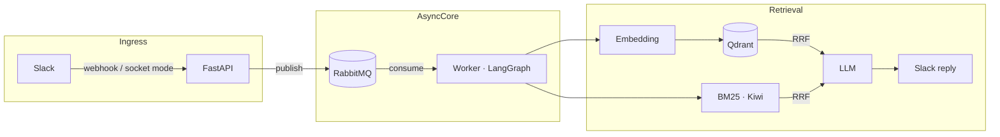

# Event-Driven RAG System

슬랙에서 "이 장애 전에도 있었어?"라고 물으면, 과거 장애 이력을 검색해 근거 티켓과 함께 답하는 이벤트 기반 RAG 시스템.

<!-- TODO(3주차): 데모 GIF — 슬랙 질문 → "유사 사례 2건 발견 (INC-0342, INC-1187)" 답변, 10초 이내 -->

Python · FastAPI · RabbitMQ · LangGraph · Qdrant · Kiwi/BM25 · Docker Compose

## 아키텍처



## 결과

| 검색 방식 | Recall@5 (합성 티켓) | Recall@5 (GitHub 이슈) |
|---|---|---|
| 벡터 only | TBD | TBD |
| BM25 only | TBD | TBD |
| 하이브리드 (RRF) | TBD | TBD |

<!-- 숫자는 domains/*/eval/experiments.jsonl 에서 가져온다. 측정 전엔 비워둔다. -->

## 설계 결정

<!-- 각 3줄 이내. docs/log/ 의 "결정" 칸에서 가져온다. -->
- **RabbitMQ (Kafka 대신)** — 작업 큐 문제이고 DLQ·재시도가 내장. 처리량이 아니라 공정 분배와 유실 방지가 요구사항.
- **원인 카탈로그 → 합성 티켓** — root_cause는 사람이 고정, LLM은 표현만 생성. 역분류 검증으로 라벨 일관성 확보.
- (3주차) RRF, Kiwi 사용자 사전, at-least-once + 멱등성 키

## 실행

```bash
python -m venv .venv && source .venv/bin/activate
pip install -r requirements.txt
cp .env.example .env            # LLM 키 입력
python -m scripts.generate_tickets --per-cause 8
python -m scripts.validate_tickets
python -m rag.index
python ask.py "펌프다운이 평소보다 오래 걸리는데 예전에 비슷한 일 있었어?"
python -m scripts.build_evalset
python -m rag.eval --method vector
```

## 프로젝트 구조

```
domains/<domain>/        ← 도메인별 교체 단위: catalog, prompts, data, eval
rag/                     ← 도메인을 모르는 코어: embed, index, retrieve, eval
scripts/                 ← 데이터 생성·검증·평가셋
docs/log/                ← 개발 일지 (결정·실험·막힌 것·한 줄)
```

## 한계와 다음 단계

- 합성 데이터 — 실제 장애 텍스트의 노이즈는 노이즈 주입 실험과 GitHub 이슈 교차 검증으로 보완 (3주차)
- 알람 코드·설비 ID는 가상 체계
- 멀티턴 대화 미지원 (thread_id는 스키마에 예약)
