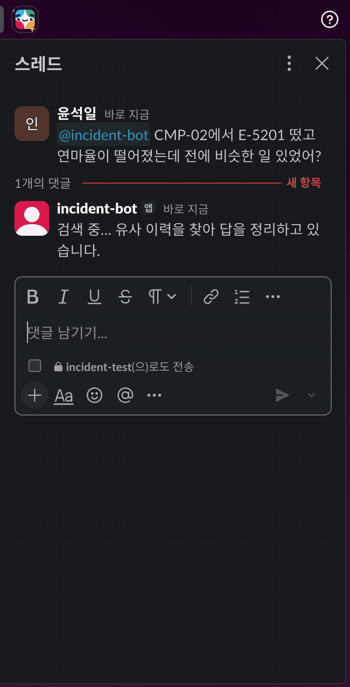
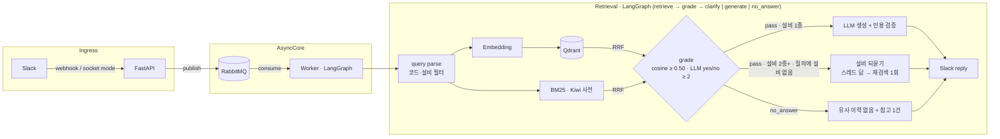

# Event-Driven RAG System

슬랙에서 "이 장애 전에도 있었어?"라고 물으면, 과거 장애 이력을 검색해 근거 티켓과 함께 답하는 이벤트 기반 RAG 시스템.



실시간 녹화 26초 · 질문→답변 19.4초(로그 기준). CMP-02 · E-5201 질문 → "검색 중…" → 근거 티켓 2건 답변(Slack 스레드 패널).

Python · FastAPI · RabbitMQ · LangGraph · Qdrant · Kiwi/BM25 · Docker Compose

## 아키텍처



## 결과

합성 티켓 318건 · 평가셋 170행(positive 139 + negative 31) · k=5 · 같은 색인(bge-m3). 전 행은 `domains/manufacturing/eval/experiments.jsonl`, 요약은 docs/experiments/week3_summary.md. (11-03에 사용자가 질의 108행을 더 써서 283행(human 124 = #human 10 + 사용자 추가 초안 114, negative 39)으로 재평가 — 소표는 아래. 숫자는 docs/log/2026-11-02.md. 메인 표는 170행 기준.)
R@5는 벡터 only에서 이미 0.885라 하이브리드로 변하지 않는다 — 보는 지표는 **R@1·MRR**과 negative 처리율.

| 검색 방식 | human R@1 / MRR | 코드 단독 질의 (E-1101 · PECVD-03 E-1101 · E-5201) | overall R@1 / R@5 / MRR | negative "이력 없음" (31건) | GitHub 이슈 (docker/compose 중복 46쌍, 코퍼스 2600) R@5 [95% CI] |
|---|---|---|---|---|---|
| 벡터 only | 0.632 / 0.724 | 0/5 · 1/5 · 5/5 | 0.763 / 0.885 / 0.636 | — | 0.630 [0.478, 0.761] |
| BM25 only (Kiwi, 사전 80) | 0.684 / 0.784 | 5/5 · 5/5 · 5/5 | 0.727 / 0.856 / 0.613 | — | 0.609 [0.478, 0.739] (영문 토크나이저: 어간·불용어·식별자) |
| 하이브리드 (RRF k=60, 1:1) | 0.737 / 0.798 | 3/5 · 3/5 · 5/5 | 0.784 / 0.885 / 0.656 | — | **0.783** [0.652, 0.891] |
| 하이브리드 + 메타데이터 필터 | **0.789 / 0.842** | **5/5 · 5/5 · 5/5** | **0.791 / 0.885 / 0.665** | — | |
| + negative grade (LangGraph) | 검색 동일 | 검색 동일 | R@5 0.885 유지 (판정이 거른 정답 0) | **0.968** · positive 오판 0.014 · LLM 5.67회/질의 · 지연 16.3s(+4.7s) | |
| + 설비 되묻기 (LangGraph Step 9, 11-03) | 현실 문체 124행: R@5 0.75 → **0.831**, R@1 0.492 → 0.581 (되묻기에 사용자가 정답 설비로 답했을 때 · 상한 0.871) | 발동 0 (코드·설비 질의는 묻지 않음) | 170행 표는 변동 없음(발동은 설비 없는 증상 질의만) | 발동 0/39 (grade 뒤라 "이력 없음" 유지) · 발동 44/124 · 발동 건 LLM 11회 | |

**현실 문체 질의 124건(사람 10 · ChatGPT 초안 95 · Claude 초안 19)** — 11-03, 283행 평가셋 기준(negative 39 별도). 사람 10 = 사용자가 직접 쓴 줄(`#human`), ChatGPT 초안 = 사용자가 7개 유형(설비 생략·구어/오타·맥락 노이즈·코드·복합 증상·조치/시간·과거 이력)으로 추가한 108줄 중 positive 95, Claude 초안 = 1주차 19줄.

| 검색 방식 | 124 R@1 / R@5 / MRR | 사람 10 R@5 | ChatGPT 초안 95 R@5 | Claude 초안 19 R@5 |
|---|---|---|---|---|
| 벡터 only | 0.444 / 0.637 / 0.523 | 0.4 | 0.621 | 0.842 |
| BM25 only | 0.435 / 0.669 / 0.518 | **0.5** | 0.632 | **0.947** |
| 하이브리드 | 0.452 / 0.734 / 0.541 | **0.6** | 0.716 | 0.895 |
| 하이브리드 + 메타데이터 필터 | **0.492 / 0.75 / 0.579** | **0.6** | **0.737** | 0.895 |
| + 설비 되묻기, 사용자가 정답 설비로 답(실측, 발동 44/124) | 0.581 / **0.831** | 0.6 → 0.8 | 0.737 → 0.853 | 0.895 → 0.895 |
| + 정답 설비 강제 필터(되묻기 상한) | 0.581 / 0.871 | | | |

실패(하이브리드+필터 R@5 0) 31건 중 약 18건은 증상이 복수 원인에 걸쳐 설비 없이는 미결정("진공이 계속 떨어진다" = PECVD O-ring·드라이펌프 / PVD 크라이오펌프 / ETCH 스로틀 밸브, "히터 온도가 안 올라온다" = PHOTO 핫플레이트 / PECVD 서셉터 / PVD 웨이퍼 히터). 나머지는 카탈로그가 confusable로 선언한 같은 설비 안의 이웃 원인(연마 패드 ↔ 컨디셔너·슬러리). 정답 티켓의 설비 종류를 필터로 강제하면(사용자가 설비를 답했을 때의 상한) 124건 R@5 0.75 → 0.871. 실제 되묻기 노드(grade 통과 티켓이 설비 2종 이상 + 질의에 설비·코드 없음)는 44건에 발동, 사용자가 정답 설비로 답하면 0.831(발동 44건만 보면 0.682 → 0.909), negative 39건에는 발동 0. 발동 안 한 실패 17건은 연마 패드(8)·O-ring(5)·핫플레이트(3) — 같은 설비 안의 confusable이라 그룹(정답 ∪ confusable) R@5로는 0.529. 유형별로는 코드만 질의가 필터로 1.0, 설비 생략 질의가 0.62 → 0.76.

- paraphrase_hard(티켓 용어를 전혀 안 쓴 질의 30행)는 R@5 0.60 → 0.567로 하이브리드가 못 살린다. 임베딩 한계로 두고 숫자만 보고한다.
- negative는 cosine 임계값만으로 분리되지 않는다(positive min 0.535 vs negative max 0.613 겹침). 임계값은 안전선(0.50), 판정은 LLM(티켓별 yes/no, 5건 중 2건 이상).
- 노이즈 주입(79행, 규칙 기반 오타·약어): 오타 30%는 어느 쪽도 안 무너지고, 약어+오타 30%에서 벡터만 R@5 0.962 → 0.924. 하이브리드는 전 세트 0.975 유지(R@1만 0.924 → 0.886). 사전·코드 정규식 기여는 ±0.013로 분리 불가. graph(LLM 판정) 행은 오타 1~2곳·약어 세트만 측정(잘못 "이력 없음" 1.4%), 30% 세트는 미완(API 장애 — OpenAI 크레딧 소진). docs/log/2026-11-02.md Step 7.
- GitHub 이슈(실제 텍스트, 영문): 중복 이슈 → 원본 찾기. R@5 방향은 합성과 같다(hybrid > vector > bm25). 토크나이저는 도메인 설정(`tokenizer.yaml`)으로 교체 — 영문은 어간·불용어·snake_case/버전 보존. n=46이라 CI가 겹친다. 수집·누수 차단 규칙은 `scripts/collect_github_issues.py`.

## 설계 결정

<!-- 각 3줄 이내. docs/log/ 의 "결정" 칸에서 가져온다. -->
- **RabbitMQ (Kafka 대신)** — 작업 큐 문제이고 DLQ·재시도가 내장. 처리량이 아니라 공정 분배와 유실 방지가 요구사항.
- **원인 카탈로그 → 합성 티켓** — LLM 보조로 초안을 작성하고 학부 반도체 공정 지식으로 검토한 가상 카탈로그(검토 범위는 docs/catalog_review.md). root_cause는 사람이 고정, LLM은 표현만 생성. 역분류 검증(2심 + 사람 판정, docs/labeling_policy.md)으로 라벨 일관성 확보.
- **RRF 1:1 고정 (가중치 튜닝 안 함)** — 평가셋 170행에 맞추면 과적합. 순위만 쓰므로 cosine·BM25 스케일 차이를 정규화할 필요가 없다. 코드 질의는 섞지 않고 라우팅(코드 → BM25만)으로 푼다.
- **Kiwi 사용자 사전은 자동 검출** — 카탈로그 구절을 문맥째 분석해 기본 Kiwi가 잘못 쪼개는 단어(베인→베이+ㄴ, 리크→리+크, 미도달→미+도달)만 등록(80개). 전부 올리면 145개가 효과 없는 항목이었다.
- **"모른다"는 LLM 판정 노드** — cosine 임계값은 negative 9할을 잡으려면 positive 1할을 버린다. 티켓별 yes/no + "5건 중 2건 이상" 규칙으로 negative 0.968·정답 유실 0. 배치 1회 판정은 전 지표 열세로 기각.
- **설비 되묻기는 grade 뒤에** — 검색 결과만 보면 negative 39건 중 25건이 "설비 혼재"로 되묻기에 걸려 "이력 없음"을 가린다. LLM 판정이 negative를 거른 뒤, 통과 티켓이 설비 2종 이상일 때만 묻는다(LLM 추가 호출 0, 되물은 질의만 판정 2회). 왕복은 스레드당 1회(Redis 300s).
- **at-least-once + 멱등성 키의 수명** — drain 타임아웃으로 버린 메시지는 브로커가 돌려주지만 멱등 키가 살아 있으면 다음 워커가 중복으로 버린다(유실 창 300s). 버리는 순간 키를 놓게 해 0으로.

## 기각된 실험

| 실험 | 결과 | 왜 기각 |
|---|---|---|
| symptom_only 색인 (증상만, 조치 기록 제외) | overall R@5 0.853 → 0.872, 사람 질의 0.842 → 0.789 | 오른 건 LLM 질의가 출처 티켓 증상을 바꿔 쓴 착시. 사람 질의가 떨어진다 (1주차) |
| Kiwi 사전 v1 (카탈로그 단어 전부 188개) | v2(잘못 쪼개지는 단어만 80개)와 R@5 0.842 vs 0.856 | 145개는 Kiwi가 이미 한 토큰으로 보는 단어 — 효과 없는 항목. 자동 검출로 교체 |
| grade 배치 1회 판정 (5건 한 호출) | negative 0.871 · positive 오판 0.072 · 정답 6건 거름 · 20.8s | 호출 수만 1/3, 정확도·지연 전부 열세. 목록 안 상대 비교로 yes가 흔들린다 |
| RRF 가중치 튜닝 | 하지 않음 | 평가셋 170행에 맞추면 과적합. 코드 질의는 가중치 대신 라우팅으로 |

## 신뢰성 (실험으로 확인한 것)

| 상황 | 결과 | 어디에 |
|---|---|---|
| 브로커 재시작 (메시지 10건 적재 후 `restart rabbitmq`) | 유실 0 (durable 큐 + persistent 메시지) | docs/log/2026-10-29 |
| 워커 종료 중 LLM 호출 (`docker compose stop worker`) | 처리 중 1건을 끝내고 나감(drain 120s), 답 도착, ai_tasks 0 | docs/log/2026-10-29 |
| 처리 실패 3회 | 5s → 25s → 125s 재시도 큐 → DLQ(원문·마지막 오류 보존) | tests/test_worker.py |
| 같은 event_id 2회 (Slack 재전송) | 1회만 처리 (Redis SET NX, 24h). Redis 장애면 가드 없이 처리 | tests/test_worker.py |
| **drain 타임아웃 초과** (`WORKER_DRAIN_TIMEOUT=5`) | requeue는 되지만 멱등 키 때문에 300s 동안 중복으로 버려졌다 → 버릴 때 키 release로 유실 창 0 | docs/log/2026-11-02, test_k |
| shell form CMD (PID 1 = sh) | SIGTERM이 python에 안 가 처리 중 답이 SIGKILL과 함께 사라짐 → exec form + tini | docs/week2_summary.md |

## 실행 (Docker Compose)

전체 경로가 컨테이너 6개로 돈다: `slack`(Socket Mode) 또는 `api`(웹훅) → `rabbitmq` → `worker`(bge-m3 + `qdrant` + LLM) → `ai_results` → `slack`(질문 스레드에 답글). `redis`는 멱등성 키.

```bash
cp .env.example .env                     # LLM_API_KEY, SLACK_BOT_TOKEN(xoxb-), SLACK_APP_TOKEN(xapp-) 입력. 웹훅만 쓰면 SLACK_SIGNING_SECRET (*_URL은 compose가 서비스명으로 덮어씀)
pip install -r requirements.txt && python -m rag.bm25_index   # 최초 1회: BM25 색인(domains/*/artifacts/bm25, 호스트에서 생성 — 컨테이너는 domains/를 읽기 전용으로 마운트하고 워커 warmup이 이 색인을 요구한다)
docker compose up --build -d             # 6개 healthy까지 1~2분 (worker는 bge-m3 로드 후 healthy)
docker compose run --rm worker python -m rag.index   # 최초 1회: 티켓 318건을 qdrant에 적재
docker compose ps                        # 전부 healthy 확인
```

Slack에서 봇을 멘션하면(`@incident-bot 펌프다운이 평소보다 오래 걸리는데`) 스레드에 "검색 중…"이 먼저 달리고, 워커가 답을 만들면 같은 스레드에 근거 티켓과 함께 답글이 달린다. 봇을 채널에 초대해야 하고, 앱에는 Socket Mode·`app_mentions:read`·`chat:write`·`im:history`가 필요하다.
웹훅 경로도 그대로 있다: Slack 이벤트(또는 서명된 curl)를 `POST http://localhost:8000/events`로 보내면 워커가 답을 `ai_results` 큐에 넣고 `slack`이 전송한다.
큐 상태는 http://localhost:15672 (guest/guest). 워커 종료는 `docker compose stop worker` — 처리 중인 1건을 끝내고(최대 120초) 나간다.

- 모델 가중치(bge-m3, ~2GB)는 이미지에 넣지 않고 호스트 `~/.cache/huggingface`를 마운트한다. 첫 실행 때 받는다.
- 티켓 데이터(`domains/*/data/*.jsonl`, gitignore)는 `./domains`를 읽기 전용으로 마운트한다.
- 큐·실패 경로·멱등성 규칙은 docs/events.md.

## 개발용 (로컬 실행)

```bash
python -m venv .venv && source .venv/bin/activate
pip install -r requirements.txt
cp .env.example .env            # LLM 키 입력. QDRANT_URL 비우면 ./.qdrant 로컬 파일 모드
python -m scripts.generate_tickets --per-cause 8
python -m scripts.validate_tickets
python -m rag.index
python -m rag.bm25_index         # BM25 색인 (Kiwi 사용자 사전은 catalog.yaml에서 자동 검출)
python ask.py "펌프다운이 평소보다 오래 걸리는데 예전에 비슷한 일 있었어?"
python -m scripts.build_evalset
python -m rag.eval --method vector

docker compose up -d rabbitmq redis      # 브로커만 컨테이너로
uvicorn api.webhook:app --port 8000      # 웹훅
python -m worker.main                    # 워커 (Ctrl+C = graceful drain)
python -m pytest                         # 유닛 + integration(브로커 없으면 skip)
```

## 프로젝트 구조

```
domains/<domain>/        ← 도메인별 교체 단위: catalog, prompts, data, eval, tokenizer.yaml, artifacts/bm25 (gitignore)
rag/                     ← 도메인을 모르는 코어: embed, index, bm25_index, tokenize, query_parse, retrieve, graph, pipeline, eval
worker/ adapters/ api/   ← 큐 소비자, Slack Socket Mode·답글, 웹훅
scripts/                 ← 데이터 생성·검증·평가셋·노이즈·GitHub 이슈 수집·그래프 평가
docs/log/                ← 개발 일지 (결정·실험·막힌 것·한 줄)
```

## 계획 대비 실제

| 주차 | 계획 | 실제 | 산출 |
|---|---|---|---|
| 1주차 검색 기준선 | 5일 | 4일 (10-26 ~ 10-29) | 합성 티켓 318건, 평가셋 170행, Recall@5 0.885 — docs/experiments/week1_summary.md |
| 2주차 이벤트 경로 | 5일 | 1일 (10-29) | Slack → RabbitMQ → 워커 → Slack 왕복 18.6~21.8s, 컨테이너 6개, 테스트 84 — docs/week2_summary.md |
| 3주차 하이브리드·평가 | 5일 | 2일 (11-02 ~ 11-03, Step 0~8) | BM25·RRF·메타데이터 라우팅·LangGraph grade(negative 0.968), GitHub 교차 검증, 노이즈 주입, 데모 GIF, 테스트 86 유닛 + 11 통합 — docs/experiments/week3_summary.md |

## 한계와 다음 단계

- paraphrase_hard(용어를 전혀 안 쓴 질의) R@5 0.567 — 어휘 매칭으로 구제되지 않는 임베딩 한계. 개선 대상에서 제외하고 숫자만 보고한다.
- 현실 문체 질의 124건(R@5 0.75)의 실패 31건 중 약 18건은 증상이 복수 원인에 걸쳐 설비 없이는 미결정(진공 저하·히터 온도는 설비 3종에 같은 증상) — 검색이 아니라 정답 정의(1 cause)의 한계. 설비 되묻기 노드(Step 9)로 사용자가 정답 설비를 답하면 R@5 0.831(상한 0.871, 발동 44/124). 남는 실패 21건 중 17건은 되묻기가 발동하지 않은 같은 설비 안의 confusable(연마 패드 ↔ 컨디셔너·슬러리, O-ring ↔ 드라이펌프) — 설비가 아니라 세부 신호(글레이징·베인 전류)를 되물어야 하고, 그건 미구현. 되묻기는 스레드당 1회, 왕복 1회분 지연과 판정 2회(LLM 11회/질의)가 비용.
- negative 31건 중 1건은 아직 답한다("센서·커넥터" 어휘 겹침). positive 2건은 잘못 "이력 없음"(검색 자체가 빗나간 1, 집계 답에 인용이 빠진 1).
- 지연: 판정 추가로 질의당 +4.7s(평균 16.3s, p95 29.0s). 생성 LLM(10.9s)이 대부분, 판정은 병렬이라 더 못 줄인다.
- 합성 데이터 — 실제 장애 텍스트의 노이즈는 노이즈 주입 실험과 GitHub 이슈 교차 검증으로 보완 (Step 6·7)
- 알람 코드·설비 ID는 가상 체계
- 멀티턴 대화 미지원 (thread_id는 스키마에 예약)
