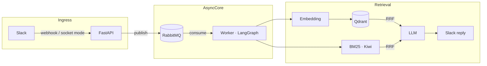

# Event-Driven RAG System

슬랙에서 "이 장애 전에도 있었어?"라고 물으면, 과거 장애 이력을 검색해 근거 티켓과 함께 답하는 이벤트 기반 RAG 시스템.

<!-- TODO(3주차): 데모 GIF — 슬랙 질문 → "유사 사례 2건 발견 (INC-0342, INC-1187)" 답변, 10초 이내 -->

Python · FastAPI · RabbitMQ · LangGraph · Qdrant · Kiwi/BM25 · Docker Compose

## 아키텍처



## 결과

| 검색 방식 | Recall@5 (합성 티켓) | Recall@5 (GitHub 이슈) |
|---|---|---|
| 벡터 only | overall 0.885 / paraphrase 1.0 / paraphrase_hard 0.60 / human 0.842 <!-- 2026-10-29, bge-m3, doc_text=full, eval 139 positive (exact·paraphrase·paraphrase_hard·multi_hop 30 + human 19); baseline 177c16c was 0.853 before paraphrase split --> | TBD |
| BM25 only | overall 0.856 / paraphrase 1.0 / paraphrase_hard 0.40 / human 0.947 <!-- 2026-11-02, Kiwi+bm25s, 사용자 사전 80, doc_text=full --> | TBD |
| 하이브리드 (RRF) | overall 0.885 / paraphrase 1.0 / paraphrase_hard 0.567 / human 0.895 (R@1 0.784, MRR 0.656) <!-- 2026-11-02, vector top-20 + bm25 top-20, RRF k=60, 1:1 --> | TBD |
| 하이브리드 + 메타데이터 필터 | overall 0.885 / paraphrase 1.0 / paraphrase_hard 0.567 / human 0.895 (R@1 0.791, MRR 0.665 — 최고; 코드 단독 질의 5/5) <!-- 2026-11-02, 알람 코드→BM25 only, 설비 타입→payload filter, 170행 중 38에 적용 --> | TBD |
| + negative grade (LangGraph) | R@5 0.885 유지(판정이 거른 정답 0) · **negative 31건 중 "이력 없음" 0.968** · positive 오판 0.014 · 지연 +4.7s <!-- 2026-11-02, cosine<0.50 게이트 + gpt-5-mini 티켓별 yes/no, yes≥2, scripts/eval_graph.py --> | TBD |

<!-- 숫자는 domains/*/eval/experiments.jsonl 에서 가져온다. 측정 전엔 비워둔다. -->

## 설계 결정

<!-- 각 3줄 이내. docs/log/ 의 "결정" 칸에서 가져온다. -->
- **RabbitMQ (Kafka 대신)** — 작업 큐 문제이고 DLQ·재시도가 내장. 처리량이 아니라 공정 분배와 유실 방지가 요구사항.
- **원인 카탈로그 → 합성 티켓** — LLM 보조로 초안을 작성하고 학부 반도체 공정 지식으로 검토한 가상 카탈로그(검토 범위는 docs/catalog_review.md). root_cause는 사람이 고정, LLM은 표현만 생성. 역분류 검증(2심 + 사람 판정, docs/labeling_policy.md)으로 라벨 일관성 확보.
- (3주차) RRF, Kiwi 사용자 사전, at-least-once + 멱등성 키

## 실행 (Docker Compose)

전체 경로가 컨테이너 6개로 돈다: `slack`(Socket Mode) 또는 `api`(웹훅) → `rabbitmq` → `worker`(bge-m3 + `qdrant` + LLM) → `ai_results` → `slack`(질문 스레드에 답글). `redis`는 멱등성 키.

```bash
cp .env.example .env                     # LLM_API_KEY, SLACK_BOT_TOKEN(xoxb-), SLACK_APP_TOKEN(xapp-) 입력. 웹훅만 쓰면 SLACK_SIGNING_SECRET (*_URL은 compose가 서비스명으로 덮어씀)
docker compose up --build -d             # 6개 healthy까지 1~2분 (worker는 bge-m3 로드 후 healthy)
docker compose run --rm worker python -m rag.index   # 최초 1회: 티켓 318건을 qdrant에 적재
docker compose ps                        # 전부 healthy 확인
```

Slack에서 봇을 멘션하면(`@incident-bot 펌프다운이 평소보다 오래 걸리는데`) 스레드에 "검색 중…"이 먼저 달리고, 워커가 답을 만들면 같은 스레드에 근거 티켓과 함께 답글이 달린다. 봇을 채널에 초대해야 하고, 앱에는 Socket Mode·`app_mentions:read`·`chat:write`·`im:history`가 필요하다.
웹훅 경로도 그대로 있다: Slack 이벤트(또는 서명된 curl)를 `POST http://localhost:8000/events`로 보내면 워커가 답을 `ai_results` 큐에 넣고 `slack`이 전송한다.
큐 상태는 http://localhost:15672 (guest/guest). 워커 종료는 `docker compose stop worker` — 처리 중인 1건을 끝내고(최대 120초) 나간다.

- 모델 가중치(bge-m3, ~2GB)는 이미지에 넣지 않고 호스트 `~/.cache/huggingface`를 마운트한다. 첫 실행 때 받는다.
- 티켓 데이터(`domains/*/data/*.jsonl`, gitignore)는 `./domains`를 읽기 전용으로 마운트한다.
- 큐·실패 경로·멱등성 규칙은 docs/events.md.

## 개발용 (로컬 실행)

```bash
python -m venv .venv && source .venv/bin/activate
pip install -r requirements.txt
cp .env.example .env            # LLM 키 입력. QDRANT_URL 비우면 ./.qdrant 로컬 파일 모드
python -m scripts.generate_tickets --per-cause 8
python -m scripts.validate_tickets
python -m rag.index
python ask.py "펌프다운이 평소보다 오래 걸리는데 예전에 비슷한 일 있었어?"
python -m scripts.build_evalset
python -m rag.eval --method vector

docker compose up -d rabbitmq redis      # 브로커만 컨테이너로
uvicorn api.webhook:app --port 8000      # 웹훅
python -m worker.main                    # 워커 (Ctrl+C = graceful drain)
python -m pytest                         # 유닛 + integration(브로커 없으면 skip)
```

## 프로젝트 구조

```
domains/<domain>/        ← 도메인별 교체 단위: catalog, prompts, data, eval
rag/                     ← 도메인을 모르는 코어: embed, index, retrieve, eval
scripts/                 ← 데이터 생성·검증·평가셋
docs/log/                ← 개발 일지 (결정·실험·막힌 것·한 줄)
```

## 계획 대비 실제

| 주차 | 계획 | 실제 | 산출 |
|---|---|---|---|
| 1주차 검색 기준선 | 5일 | 4일 (10-26 ~ 10-29) | 합성 티켓 318건, 평가셋 170행, Recall@5 0.885 — docs/experiments/week1_summary.md |
| 2주차 이벤트 경로 | 5일 | 1일 (10-29) | Slack → RabbitMQ → 워커 → Slack 왕복 18.6~21.8s, 컨테이너 6개, 테스트 84 — docs/week2_summary.md |
| 3주차 하이브리드·평가 | 5일 | — (11-02 시작 예정) | docs/week3_checklist.md |

## 한계와 다음 단계

- 합성 데이터 — 실제 장애 텍스트의 노이즈는 노이즈 주입 실험과 GitHub 이슈 교차 검증으로 보완 (3주차)
- 알람 코드·설비 ID는 가상 체계
- 멀티턴 대화 미지원 (thread_id는 스키마에 예약)
