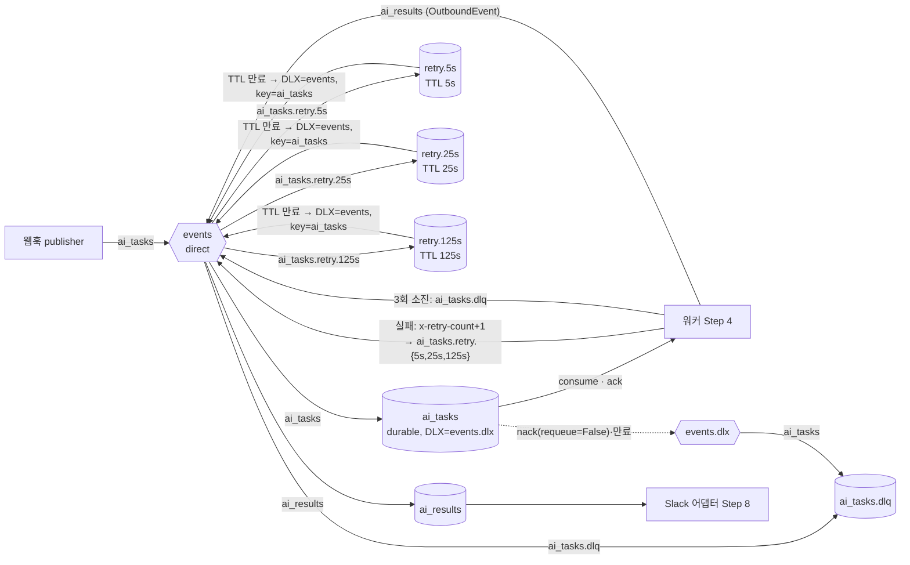

# 이벤트 계약 · 큐 토폴로지 · 실패 경로

2주차 산출물. 어댑터(Slack/HTTP) ↔ RabbitMQ ↔ 워커 사이를 오가는 데이터 형식과 큐 구조를 한 곳에 둔다.
코드: `events/contracts.py`, 테스트: `tests/test_contracts.py` (`python -m pytest`).

## 1. 계약 (version 1)

공통 규칙
- `version`은 `Literal[1]`. 다른 값은 검증 실패. 형식을 바꾸면 숫자를 올리고 소비자가 명시적으로 분기한다.
- 모르는 필드는 거부(`extra="forbid"`). 오타가 조용히 버려지는 것보다 422가 낫다.
- 모델은 불변(`frozen=True`). 워커는 inbound를 고치지 않고 `reply()`로 새 outbound를 만든다.
- `ts`는 timezone-aware만 허용. naive datetime은 어댑터마다 기준이 달라 순서·TTL 계산을 망친다.
- 직렬화: `to_json()` / `from_json()` (pydantic `model_dump_json` / `model_validate_json`). JSON 안에서 `ts`는 ISO 8601 오프셋 포함.

### InboundEvent — 사용자 질문 1건 (`events.inbound`)

| 필드 | 타입 | 필수 | 설명 |
|---|---|---|---|
| version | 1 | 기본 1 | 스키마 버전 |
| event_id | str (1~128) | ✔ | **생산자가 정하는 멱등 키.** 기본값 없음. 같은 질문의 재전송은 같은 값을 써야 Step 5 멱등 가드가 작동. Slack은 이벤트 ID, HTTP 클라이언트는 자기 uuid |
| source | str (≥1) | ✔ | 어댑터 이름(`slack`/`http`/`cli` …). 등록된 어댑터인지는 계약이 아니라 라우터(Step 2)가 검증 |
| channel | str | ✔ | **어댑터가 해석하는 불투명 문자열.** Slack은 채널 ID, HTTP는 호출자 식별자, CLI는 `terminal`. 코어는 내용을 보지 않고 그대로 outbound로 복사 |
| user | str | ✔ | 질문자 ID |
| text | str (1~2000) | ✔ | 질문 원문. 앞뒤 공백 제거, 공백만이면 거부 |
| ts | datetime (tz-aware) | 기본 now(UTC) | 질문 발생 시각 |
| reply_to | str \| null | 기본 null | **어댑터가 해석하는 불투명 문자열.** Slack은 `thread_ts`. null이면 질문 자체가 새 스레드 |

### OutboundEvent — 질문 1건에 대한 답 1건 (`events.outbound`)

| 필드 | 타입 | 필수 | 설명 |
|---|---|---|---|
| version | 1 | 기본 1 | 스키마 버전 |
| event_id | str | 기본 uuid4 | 답 이벤트 자체의 ID |
| in_reply_to | str | ✔ | 답하는 `InboundEvent.event_id` |
| channel | str | ✔ | inbound에서 복사(불투명 문자열). 답 보내는 쪽이 inbound를 다시 조회하지 않게 |
| reply_to | str \| null | 기본 null | 답을 달 스레드(Slack thread_ts). `inbound.reply_to` 있으면 그 값, 없으면 `inbound.event_id`. Slack 어댑터는 항상 질문 메시지 ts를 넣으므로 실제로는 늘 thread_ts |
| text | str (≤4000) | ✔ | 답변 본문. `status=answered`면 비어 있을 수 없음 |
| citations | list[Citation] | 기본 [] | 근거 티켓. `Citation = {ticket_id: "INC-…", score: float\|null (−1~1)}` |
| status | `answered` \| `no_match` \| `error` \| `progress` | ✔ | answered: 근거 있는 답 / no_match: "유사 이력 없음" / error: 처리 실패 / progress: "검색 중…" 같은 중간 알림(Step 7 추가. 지금은 Socket 어댑터가 큐를 거치지 않고 직접 보낸다) |
| error | str \| null | status=error면 ✔ | 실패 사유. status≠error면 있으면 안 됨 |
| ts | datetime (tz-aware) | 기본 now(UTC) | 답 생성 시각 |

체크리스트 초안(event_id, in_reply_to, text, citations, status)에 `channel`·`reply_to`·`error`·`ts`를 더했다.
이유: outbound 소비자(Slack 어댑터)가 상태 없이 "어디에 달지"를 알아야 재시작·중복 소비가 단순해진다. `error`는 status=error의 사유를 본문과 섞지 않기 위해.

### 예시 JSON 1쌍

InboundEvent
```json
{
  "version": 1,
  "event_id": "Ev08ABC123",
  "source": "slack",
  "channel": "C0123FAB",
  "user": "U0456ENG",
  "text": "펌프다운이 평소보다 오래 걸리는데 예전에 비슷한 일 있었어?",
  "ts": "2026-10-29T09:12:33+09:00",
  "reply_to": null
}
```

OutboundEvent (`inbound.reply(...)`로 생성)
```json
{
  "version": 1,
  "event_id": "9f1c2e7d4b5a4c0e8d6f1a2b3c4d5e6f",
  "in_reply_to": "Ev08ABC123",
  "channel": "C0123FAB",
  "reply_to": "Ev08ABC123",
  "text": "(1) 유사 사례: 펌프다운 지연 2건 [INC-2026-0012][INC-2026-0015] … (3) 확인 순서: 1) 포라인 밸브 …",
  "citations": [
    {"ticket_id": "INC-2026-0012", "score": 0.71},
    {"ticket_id": "INC-2026-0015", "score": 0.66}
  ],
  "status": "answered",
  "error": null,
  "ts": "2026-10-29T09:12:40+09:00"
}
```

## 2. 입구: POST /events (Slack Events API)

| 상황 | 응답 | 이유 |
|---|---|---|
| 서명 헤더 없음·불일치·타임스탬프 ±5분 밖 | 401 | 재전송 공격 차단. 비밀은 `SLACK_SIGNING_SECRET` |
| `SLACK_SIGNING_SECRET` 미설정 | 503 | 검증 없이 받지 않는다 |
| JSON 파싱 실패 | 400 | |
| `url_verification` | 200 `{challenge}` | Slack 앱 URL 등록 시 1회 |
| `event_callback` → InboundEvent 검증 실패(멘션만 있는 빈 질문 등) | 200 ignored + WARNING 로그 | 422면 Slack이 재전송한다. 질문이 아닌 건 조용히 버린다 |
| 봇 글·편집(subtype)·채널 일반 메시지·미지 타입 | 200 ignored | Slack은 2xx가 아니면 재전송하므로 무시도 2xx |
| publish 예외 | 503 | 큐 장애를 삼키지 않는다. Slack이 재전송(X-Slack-Retry-Num) |
| 정상 | 202 `{event_id}` | 큐에 들어갔다는 뜻. 답은 비동기 |

처리 대상: `app_mention`, DM(`message` + `channel_type=im`). 멘션 토큰(`<@U…>`)은 제거. `event_id`=Slack event_id, `ts`=event.ts(epoch→UTC), `reply_to`=thread_ts(스레드 안 질문) 또는 메시지 ts(새 질문) — 답은 항상 질문 스레드에 달린다(Step 7에서 바꿈. 전에는 새 질문이면 null이라 Slack에 달 곳이 없었다).

## 2-b. 입구·출구: Slack Socket Mode (`adapters/`, Step 7)

웹훅 대신 WebSocket(앱 토큰 `xapp-`)으로 받는다 — 공개 URL·서명 검증 불필요. 한 프로세스(`python -m adapters.slack_main`, compose `slack` 서비스)가 둘을 돈다.

| 구성 | 역할 | 실패 시 |
|---|---|---|
| `slack_socket.py` (Bolt AsyncApp) | app_mention·DM → `api.slack.to_inbound(source="slack_socket")` 재사용 → `ai_tasks` publish → 질문 스레드에 "검색 중…" | publish 실패: 사용자에게 "접수 불가" 한 줄 + ERROR 로그. Bolt가 이미 envelope ack → Slack 재전송 없음 → **질문 유실**(웹훅의 503 재전송과 다름, 의도적 단순화) |
| `slack_reply.py` (ReplyConsumer) | `ai_results` 소비 → `format_reply` → Redis `progress:{in_reply_to}`에 "검색 중…" 메시지 ts가 있으면 `chat.update`(그 메시지가 답으로 바뀜), 없으면 `chat.postMessage(thread_ts=reply_to)` → **전송 성공 뒤 ack**, 키 삭제 | 영구 오류(channel_not_found·not_in_channel·invalid_auth…): 로그 + ack(폐기). 일시 오류(ratelimited·네트워크): 2s 뒤 nack(requeue). 독 메시지: 로그 + ack |

답글 포맷: answered = 본문 + `근거 티켓: INC-…` 줄 / no_match = "유사 이력 없음 — …" 문구(+파이프라인 본문) / error = "답변 생성에 실패했습니다…(사유)" / progress = 본문 그대로.
progress ts는 `adapters/progress.py`(Redis, TTL 1h, 실패 시 폴백=새 답글). update가 message_not_found면 새 답글로 폴백, 레이트리밋이면 nack requeue(키 유지).
Socket 재전송으로 같은 event_id가 두 번 오면 워커 멱등 가드가 거른다(progress는 두 번 찍힐 수 있음). 채널 허용 목록 `SLACK_ALLOWED_CHANNELS`(비우면 전부).
지연 측정: `reply_to`가 Slack 메시지 ts(epoch)라 답글 소비자가 `latency_from_question`을 로그에 찍는다.

## 3. 큐 토폴로지 (`mq/topology.py`, `declare()` 한 번으로 멱등 선언)



| 이름 | 종류 | 인자 | 바인딩 |
|---|---|---|---|
| events | exchange direct, durable | | |
| events.dlx | exchange direct, durable | | |
| ai_tasks | queue durable | x-dead-letter-exchange=events.dlx | events:"ai_tasks" |
| ai_tasks.retry.5s / 25s / 125s | queue durable | x-message-ttl=5000/25000/125000, x-dead-letter-exchange=events, x-dead-letter-routing-key=ai_tasks | events:"<큐 이름>" |
| ai_tasks.dlq | queue durable | | events.dlx:"ai_tasks" (안전망) + events:"ai_tasks.dlq" (워커 직접) |
| ai_results | queue durable | | events:"ai_results" |

- 메시지: 본문 `InboundEvent.to_json()`, `delivery_mode=PERSISTENT`, `message_id=event_id`, 헤더 `x-retry-count`(0부터)·`event_id`. publisher confirms + `mandatory=True`(라우팅 안 되면 예외 → 웹훅 503).
- 재시도는 워커가 명시적으로 한다(Step 6): 실패 → `x-retry-count+1` → `retry_queue_for(n)`로 publish → 원본 ack. TTL이 끝나면 DLX를 타고 `ai_tasks`로 돌아온다. 3회(5+25+125s ≈ 2.6분) 넘으면 `ai_tasks.dlq`.
- `ai_tasks`의 DLX는 워커가 손도 못 댄 경우(nack requeue=False, 큐 길이 초과)의 안전망. 둘 다 `ai_tasks.dlq`에 모인다.
- 연결: `connect_robust`(끊기면 자동 재연결). 웹훅은 첫 요청 때 연결하므로 브로커가 죽어 있어도 프로세스는 뜨고, 그 요청만 503.
- 패키지명이 `queue`가 아니라 `mq`인 이유: `queue`는 표준 라이브러리 모듈이라 같은 이름의 패키지가 cwd에 있으면 stdlib `queue`를 가린다(concurrent.futures·logging.handlers가 깨짐).

## 4. 실패 경로 (`worker/main.py`)

워커: prefetch 1, 수동 ack. ack은 결과 publish가 confirm된 뒤에만. 파이프라인(임베딩·LLM)은 `to_thread`로 돌려 heartbeat를 막지 않는다.

| 상황 | 워커 동작 | 메시지 행방 | 확인 |
|---|---|---|---|
| 정상 | `pipeline.answer` → `ai_results` publish(confirm) → ack | ai_tasks 0, ai_results +1 | test_a, 수동(실제 LLM 17.8s) |
| 파이프라인 예외(LLM 타임아웃 90s·네트워크·버그), retry n<3 | 원본 복사 + `x-retry-count=n+1`, `x-last-error` → `ai_tasks.retry.{5s,25s,125s}` publish → ack | TTL 뒤 DLX로 `ai_tasks` 복귀(`x-death` 헤더에 expired 기록) | test_b (5s 복귀 확인) |
| 예외, retry ≥3 | `x-retry-count=4` → `ai_tasks.dlq` publish → ack | DLQ, 원문·헤더 보존 | test_c |
| 독 메시지(InboundEvent로 안 읽힘) | 재시도 없이 `ai_tasks.dlq`(`x-last-error: poison: …`) → ack | DLQ | test_d |
| 재시도/DLQ publish 자체 실패(브로커 단절) | ack 못 함, 예외 로그 | unacked → 연결 끊기면 브로커가 requeue | — |
| 워커가 손도 못 댐(nack requeue=False, 큐 초과) | — | `ai_tasks` DLX → `events.dlx` → `ai_tasks.dlq` | 토폴로지 |
| SIGTERM/SIGINT | consumer cancel → 처리 중 1건 완료·ack 대기(`WORKER_DRAIN_TIMEOUT` 120s) → 연결 종료 | 답은 ai_results에 도착, ai_tasks 0 | test_e, 수동(LLM 호출 중 Ctrl+C) |
| drain 타임아웃 초과 | 경고 로그, unacked로 두고 종료 | 연결 끊기며 브로커가 requeue → 다른 워커가 재처리 (멱등성 Step 5 전엔 중복 답 가능) | — |
| 같은 event_id 재전송(Slack 재전송·재큐·워커 재시작) | Redis `SET idem:{event_id} NX EX 86400` 실패 → "duplicate, ack only" — 파이프라인·ai_results 없음 | ack, 답 1건만 | test_f |
| Redis 불가 | WARNING "idempotency guard disabled" 후 가드 없이 처리 | 정상 처리(중복 답 가능) | test_g |

### 멱등성 키 (`worker.main.IdempotencyGuard`, Step 5)

| 시점 | 키 `idem:{event_id}` | 이유 |
|---|---|---|
| 수신 직후 | `SET … processing:{epoch} NX EX 86400` | 성공해야 처리. 실패면 중복 |
| 처리 성공(ack 뒤) | 값 `done`, TTL 24h 유지 | Slack 재전송 창은 3초지만 재큐·워커 재시작은 그보다 늦게 같은 event_id를 다시 가져온다 |
| 처리 실패(retry/dlq로 보냄) | `DEL` | 재시도 메시지는 같은 event_id — 키가 남으면 재시도가 영원히 "중복" |
| 중복인데 값이 `processing:`이고 `WORKER_STALE_PROCESSING_SEC`(300s) 넘게 오래됨 | 덮어쓰고 재처리 (WARNING "stale processing key") | 전 워커가 처리 중 죽은 흔적(ack 못 함 → 브로커 requeue). LLM 90s + drain 120s보다 길게 잡아 정상 처리 중인 다른 워커와 구분 |
| 중복인데 `processing:` 최근 | 중복 (ack only) | 다른 워커가 지금 처리 중 |
| Redis 연결 실패·타임아웃(1s) | 가드 없이 처리, WARNING | 가드 때문에 서비스가 멈추지 않게. 대가는 중복 답 가능성 |

**웹훅에는 가드를 두지 않는다.** 큐 앞에서 거르면 "publish 실패로 Slack이 재전송한 것"과 "이미 큐에 들어간 것의 재전송"을 구분할 수 없다 — 전자를 중복으로 버리면 질문이 유실된다. 웹훅은 항상 publish하고, 중복 제거는 소비 지점(워커) 한 곳에서만 한다. 알려진 틈: 결과 publish(confirm)와 `mark_done` 사이에 워커가 죽으면 키는 `processing`으로 남고 메시지는 ack됐으므로 중복 답은 없다; 결과 publish 전에 죽으면 unacked → requeue → 300s 뒤 재처리. 그 사이에 들어온 재전송만 중복으로 걸러진다.

쓰지 않는 것: `nack(requeue=True)` — 같은 실패를 즉시 반복하고 횟수를 셀 수 없다. 재시도 간격은 브로커 TTL 큐가, 횟수는 `x-retry-count` 헤더가 맡는다.
no_match는 실패가 아니다: 검색 결과 없음/최고 점수 < `MIN_SCORE`(0.45) 또는 LLM이 인용 없이 "유사 이력 없음" → `status=no_match`로 정상 publish.
